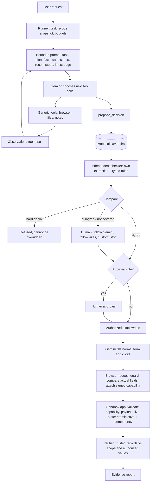

# Architecture

## Components and authority

**Boundaries**
1. The model chooses actions; the checker never operates the browser.
2. The checker reads source documents and trusted records itself; the model's extracted values are only compared, never used as input.
3. A proposal is persisted before checker feedback. Later versions (rules, human) are separate records.
4. Hard restrictions cannot be overridden from the console; soft disagreements and approvals can be decided by a human.
5. A protected write without a matching authorization is blocked in the browser and would also be rejected by the app.
6. The verifier uses the original scope and the authorized decision, not the model's completion claim.
7. Trusted read endpoints, fault switches, signing keys and credentials are unavailable to the model and blocked in its browser.
8. The request's own limits are enforced: cases it names restrict the scope; an information-only request cannot authorize writes.
9. A permission is only as good as its decision: a human stop or cancellation revokes it, a change in the records the
   decision relied on makes it stale, and the writes of one decision must happen in order.

## Company bundle (the only thing that differs per company)

| File | Contents |
|---|---|
| `profile.yaml` | Allowed paths, protected write routes mapped to action schemas, business actions the model may propose and how each becomes exact writes, values compared with the rules |
| `policies.yaml` | Typed rules: `eq/gt/lt/is_true/...`, effects `hard / hold / deny / clarify / substitute / approval`, precedence |
| `handbook.md` | Plain-English procedure given to the model |
| `adapter.py` | Deterministic fact extraction from documents/trusted records, case scope, verification of saved effects |

## Authorization transport

- One `BrowserContext.route` handler is registered before any page exists, with service workers blocked; it covers new tabs.
- Only the configured origin is reachable; restricted paths (`/api/`, `/__faults`) are refused.
- POST/PUT/PATCH/DELETE must match a mapped protected route (or the login route); unknown write routes are blocked.
- The guard parses the submitted form, keeps only schema business fields (rejecting unknown or duplicate ones), canonicalizes
  them (money to paise, quantities to 3 decimal places, whitespace) and looks for an authorized action with the same digest.
- On a match it signs a 120-second HMAC capability bound to audience, method, route, action, case, payload digest, run and
  idempotency key, injects it as `X-Operator-Authorization`, forwards with `route.fetch(max_redirects=0, max_retries=0)`
  and fulfils the page with the response.
- 5xx or connection loss means an **uncertain** result: the runtime checks the app's idempotency record through the trusted
  API. If it was committed, it is marked committed ("do not resubmit"); otherwise it is safe to retry with the same key.
- The app verifies signature, expiry, audience, route, action and digest, checks CSRF and live state (blocked vendor,
  duplicate posting, refundable balance, stock) and writes the record and the idempotency entry in one transaction.
  Replaying an identical request returns the stored result; reusing a key with different data is rejected.

## Request limits (`operator_core/taskscope.py`)

A small, documented request grammar, enforced in code:

- Scope: all open cases; the cases the request names; or all open cases except the named ones ("except",
  "excluding", "other than", ...). Case-id shapes are learned from the open cases. A named case that is not open is
  stored as *unresolved* and never widens the scope.
- Read-only: clear information-only wording ("don't change anything", "without making edits", "just prepare
  recommendations", "dry run") or the explicit flag. The gate stores proposals as recommendations, authorizes
  nothing, the guard blocks every write, and verification requires a recommendation per case and that no business
  record was added, deleted or changed (full before/after comparison of the trusted snapshots).
- Not enforceable as written (a case both requested and excluded, a partial restriction such as "do not change
  contact details", an amount or date filter): before any write the runner asks a person (`scope` decision) to
  proceed with the listed cases (reason required), switch to recommendations only, or stop. Restart-safe.
- Nothing valid to do: a request naming only missing cases ends as `needs_clarification` with no model calls; a
  valid empty queue completes with "No pending work was found."

## Keeping permissions true to the decision (`operator_core/authz.py`)

| Event | Effect |
|---|---|
| Human stops a case / rejects an approval | Persisted in `case_controls`; outstanding permissions revoked; guard re-checks at the write boundary; proposals for the case refused until a human reopens it (recorded, with a reason) |
| Operator cancels the run | Checked after each model call (returned actions discarded), before each tool, in `propose` and in the guard; unused permissions revoked; dispatched writes reconciled and reported |
| Source records change after authorization | Each permission stores its basis (checker facts, expected values, policy hash). Before the decision's first write the guard recomputes it; any difference marks the permissions stale and requires a new decision/approval |
| Second write of a decision submitted first | Blocked: writes run in the order the decision defines |
| Write outcome unknown (reconciliation failed) | Stays `uncertain`; no new decision for the case until resolved; resubmitting the same values is safe (same idempotency key) |
| Decided values internally inconsistent | Never authorized (e.g. a posting must reconcile arithmetically), even if a human follows the agent |

## Restart recovery

When a run resumes, before the model acts: submitted/uncertain writes are reconciled through the trusted idempotency
record, human decisions the dead worker was waiting for are closed as interrupted (the case must be proposed again),
stops are restored from storage, the model receives a RECOVERY summary, and the run's active time continues from the
stored value.

## Free-tier budget and capacity handoff

- Each model attempt is recorded in `model_calls` before dispatch. Caps: `MAX_MODEL_CALLS_PER_RUN`, and a daily
  allocation from `GEMINI_RPD × GEMINI_EVAL_SHARE` counted in the provider's Pacific-time day.
- Minute rate limits: bounded waits using the server's retry hint. Daily quota errors are not retried.
- Per-run cap = min(`MAX_MODEL_CALLS_PER_RUN`, the run's own cap); an evaluation suite gives each run only what is left
  of its allocation. Scripted test calls never count toward pacing or the daily allocation; the setup check is metered.
  If `GEMINI_RPD` is unset the daily protection is off and this is reported in the console, CLI and run events.
- When capacity ends, model calls stop and in-flight writes are reconciled. The **rules executor**
  (`operator_core/fallback.py`) then completes each remaining case whose rules give one determined outcome and whose
  values can all be filled from trusted records or the profile's message templates, plus unfinished obligations of
  decisions already accepted. It goes through `Gate.propose` (source `rules`), human approval, exact authorization,
  the application's own form in the same browser, the request guard, the app's validation and idempotency, and the
  verifier. Cases it cannot decide are stored as a **not executed** handoff decision; the run is then
  `waiting_for_quota` and can be resumed with Gemini from the console.

## Context management

Pinned: task (≤ 2,000 chars), mode and scope note, plan (≤ 1,500), noted facts (last 40, each value ≤ 300),
runtime-maintained case status, budget. History: the last 3 results in full, page results from the last 6 steps up
to 1,800 characters, document and decision results in full for 14 steps, older steps reduced to their first line.
Latest page observation: up to 60 elements, 20 table rows per table and 1,500 characters of page text, capped at 7,000
characters overall. A local estimate (characters / 4) keeps the **whole request** (system prompt + tool declarations +
user prompt) under `CONTEXT_TOKEN_CEILING`, narrowing history, then old facts, then the observation; if it still cannot
fit, nothing is sent. No model calls are spent on summarizing.

## Data model (data/operator.db)

`runs (incl. read_only, call_cap, active_s), events (ordered, append-only), proposals (versioned, with checker +
comparison), decisions (human), authorized_actions (exact writes + status + decision basis), case_controls (human
stop / reopen), facts, model_calls (ledger), verifications`.
